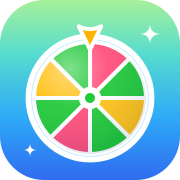
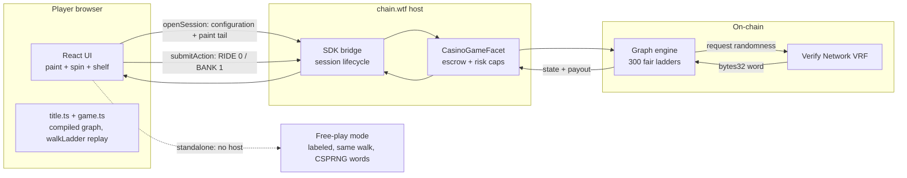

<div align="center">



# FAIRGROUND

**Paint your prizes. The wheel stays fair.**

A real-money on-chain casino game: the player paints the payout table of a fair wheel, then rides the win up a fair double-or-nothing ladder. It runs on the Chain.wtf **graph engine**, which derives the RTP from the game's math on-chain and refuses any ride that is not a fair bet. RTP is about 96% however you paint, bank or ride.

[](https://fairground.sithunyein.com)
[-1d9e57)](docs/MATH.md)
[](scripts/e2e-ladder.ts)
[](#performance)
[](LICENSE)
[](https://jam.chain.wtf)

</div>

## What it is

Every casino wheel fixes the paytable and lets the house choose it. FAIRGROUND inverts that: the player paints each slice safe, mid or risky before every spin, and the prices follow from one equation, so the more of the wheel you take risky, the less each risky slice pays. The house cannot rig a paytable it does not set, and the player cannot buy odds: RTP is about 96 percent for every legal paint.

Then the wheel gives you a decision, and keeps giving it. Land a slice and you can **bank** what it pays or **ride** it on a provably fair coin: heads doubles the hold, tails loses it. Win, and you can ride again, up to the 100x cap. Every ride is an exact 1/2 bet with no house edge, so it changes the variance and never the odds: the round returns the same ≈96% whether you paint it gentle or wild, and whether you bank at once or ride to the cap.

The game is a **graph-engine title** (`src/title.ts`): 300 fair ladders, one per legal paint composition, played by the chain's shared engine contract. There is no Solidity of our own to audit. The chain derives every configuration's RTP from the graph when the title deploys, and it refuses a title whose rides are not fair.

Real money mode runs inside chain.wtf through the official casino SDK bridge (`@chain-protocol/casino-sdk`): the player's vault balance, the host's maximum wager for the exact paint, on-chain settlement. The guest follows the host's `ui.theme` snapshot, so it renders the dark booth inside a dark host app and keeps the light carnival identity everywhere it is opened directly. The same build opened standalone runs a labeled free-play mode, which is what the jam gallery and judges see.

## How the math stays honest

| Guarantee | Mechanism |
|---|---|
| Every slice equally likely | The engine draws the tier from one VRF word, weighted by how many slices of it you painted. Which slice of that tier the pointer shows is cosmetic, derived from the same word. |
| RTP ≈96% for any paint | Slices price as SAFE = 0.2x, MID = 2L, RISKY = 6L with L = (0.96N - 0.2 cSafe) / (2 cMid + 6 cRisky), floored to a millionth of the wager. The engine reports 96.00% for every configuration; the floored prizes return 95.9999% to 96.0000%, and a payout can sit one base unit under its floored prize, never over. [docs/MATH.md](docs/MATH.md) section 4 explains both. |
| The chain trusts nothing from the client | The paint picks one of 300 bet configurations; the engine settles from the compiled graph and the VRF words. The slice layout rides in the game data's tail for display only. |
| Every ride is fair, on-chain | The engine's derive refuses any ladder step that pays above fair or more than 1/10,000 below it, and refuses rides that would reach the 100x cap. Each ride's coin is a VRF word requested by the RIDE action itself. |
| Cosmetics cannot touch payouts | Prize drops derive from the wheel's word under their own hash domain; nothing on the payout path reads them. |
| Verified | `npm run check:title` compiles the title with the SDK's compiler and holds all 300 configurations to `scripts/ladder-math.mjs`: prizes, RTP, rides allowed and every cash-out. `scripts/e2e-ladder.ts` played 72 real sessions on the simulator's chain, banks and multi-ride wins and losses, each settling exactly as the SDK's `walkLadder` replay says. Full detail in [docs/MATH.md](docs/MATH.md). |

## How the booth is laid out

The game is three screens, the way a game app is built rather than one long page. **PLAY** holds the wheel, the bet and the spin, with the last few results beside the LCD and a preview of your shelf that opens the album. **COLLECT** is the whole album: every prize in its set, each set naming the livery it pays out, with the season progress bar. **DAILY** is today's three objectives and the seven rung ladder.

On a wide screen the switcher is a segmented control under the header. On a phone it is a fixed bottom bar with thumb sized targets, the SPIN bar sits directly above it, and only the active screen is in the document, so nothing important is ever below the fold and no screen starts half scrolled. The tab badges carry live counts (prizes collected, objectives done), which is what gives a player a reason to leave the table.

## Devices

The layout is decided by two things: how wide the screen is, and how tall it is.

**One width breakpoint, at 660px.** Above it the table is side by side, wheel and controls together, the way a table should be. Below it the booth becomes a stacked app: wheel up top, the SPIN bar and the three screens pinned in the thumb zone, and only the active screen in the document. Between 660 and 860 the old layout used to stay stacked, which meant a tablet, a landscape phone and the 800x600 jam iframe all had a SPIN button below the bottom of the screen. Two columns from 660 up puts the wheel and the SPIN button on the same screen at every size that can fit both.

**Height matters too.** A wheel sized by width alone pushes the controls off a wide but short screen, which is the exact shape of the jam iframe. Above the phone breakpoint the wheel is therefore capped by height as well (`min(52vh, 430px)`), and on a viewport shorter than 560px the SPIN bar is pinned to the bottom of the window whatever the column count, so the button a player needs is never below the fold.

**Touch targets.** Desktop sizes are tuned for a cursor, so on any coarse pointer (including the touchscreen laptops that report a fine primary pointer) every control is raised to the 44px floor: presets, tier pills, icon buttons, the bet steppers, and the text actions under the bet. A viewport narrower than a laptop gets the same treatment, as a fallback for the touch devices whose pointer media query is missing or wrong.

**Instant standalone.** Opened directly, there is no host to wait for, so the game plays immediately instead of showing the connecting splash for the length of the handshake timeout. The handshake still runs, so an embed that arrives late still upgrades from demo to host with no reload.

Every one of those claims is measured, not assumed. `public/qa-viewports.html` loads the game in a same-origin iframe at ten viewports, from a 320px phone to a 1600px desktop, so the media queries genuinely re-evaluate, and reports per viewport: horizontal overflow, tap targets under 44px, the smallest rendered font, where SPIN and the nav land, how much scrolling the PLAY screen needs, and whether the first-run coach sits on the table without covering the wheel. Open it on any running copy of the site (it is served at `/qa-viewports.html`) and read `window.__QA__`.

PLAY teaches the whole mechanic without a covering manual. Three **stake shapes** (Gentle, Standard, Wild) are legal by construction, so one tap gives a newcomer a sensible paint and shows the full risk range. A **price line** under the slices reads back the trade as you paint (`6 of 12 risky - risky pays 1.56x - RTP ≈96%`), which is the part of the design that is otherwise invisible: the more of the wheel you take risky, the less each risky slice pays, and the return never moves. A refused tap is never swallowed, it shakes the panel and says why. A one-line coach (`Paint a slice, then SPIN`) retires after the first spin; the `?` crib is optional. A collapsed **Why this stays fair** panel holds the λ equation, the current paint's counts, its multipliers, its exact floored RTP and the command that proves the maths. After the wheel lands, KEEP IT / DOUBLE is the only decision, and it comes back after every winning ride with the hold and the rides left before the cap.

## Retention: the album and the daily booth

The spin is the core loop, not the whole game. Two systems sit on top of it, and both are strictly cosmetic.

**The prize album.** Every spin also drops a carnival toy, derived from the wheel's VRF word under its own hash domain: six toys across common, rare and legendary. The eighteen prizes are grouped into three sets of six, one per rarity, framed as Season 1 with a completion counter. Completing a set unlocks a wheel livery, and the seven day ladder ends in a gilded wheel. Rarity odds are 76.6 / 19.5 / 3.9 percent, so a set is a goal rather than a formality.

**The daily booth.** Three objectives rotate each day, chosen deterministically from a pool of eleven (spin volume, wins, risk appetite, a legendary drop, a completed set, sharing your wheel). The three never overlap: one per theme, so a day never asks for the same thing twice. Meeting all three banks the day and climbs a seven rung ladder of stamps, with consecutive days required and a missed day sending the run back to rung one.

Neither system can touch a multiplier, a payout or an outcome. `src/lib/missions.ts` is pure logic that never reads the game maths or the balance, and `npm run verify:missions` asserts that property alongside the board rules, so a future edit cannot quietly turn a cosmetic into an edge.

## Architecture



The round is a ladder: open a session, wait for the wheel's word, then **bank or ride** as many times as the cap allows. Each RIDE asks for a new VRF word, which is what makes every choice real: the coin cannot be read out of a word that does not exist yet. The booth replays every word with the SDK's `walkLadder`, the engine's own walk, so what it shows is what the chain settled.

## Project structure

```text
fairground/
├── deployment.ts               How chain.wtf deploys it: a graph title, src/title.ts
├── src/
│   ├── title.ts                The graph-engine title: 300 fair ladders (shared by chain, UI, checks)
│   ├── components/
│   │   ├── Wheel.tsx           Paintable SVG wheel, spin physics, peg-flex pointer
│   │   └── Prizes.tsx          Pixel prize sprites, boot wheel, brand mark
│   ├── lib/
│   │   ├── game.ts             Paint layout, game data, walkLadder replay, cosmetic draws
│   │   ├── collection.ts       Prize shelf, sets, liveries (localStorage)
│   │   ├── missions.ts         Daily objectives + seven day ladder (pure logic)
│   │   ├── sound.ts            WebAudio synth kit, zero audio assets
│   │   └── useCasinoHost.ts    SDK bridge hook: host mode, demo fallback
│   ├── App.tsx                 Booth UI, bet flow, ride ladder, stats, missions, album
│   ├── main.tsx                Entry + crash boundary
│   └── styles/fairground.css   Design system
├── scripts/
│   ├── ladder-math.mjs         Reference math for all 300 compositions, no SDK
│   ├── check-title.ts          Compiles the title, holds it to ladder-math.mjs
│   ├── e2e-ladder.ts           Real sessions on the simulator's chain vs walkLadder
│   └── verify-missions.mjs     37 rule checks: boards, banking, ladder, cosmetics
├── public/
│   ├── game.manifest.json      SDK manifest
│   └── icon-180.png.svg        Brand mark
├── docs/MATH.md                Declared math, the RTP rounding, verification
├── index.html                  Jam widget, meta, fonts
└── LICENSE                     MIT
```

## Security

- **No contract of our own.** The game is a graph title played by the chain's shared engine. The chain derives the RTP, the maximum payout and the risk quotes from the graph when the title deploys, and refuses math that breaks a rule, so there is no game Solidity to audit and no quote to get wrong.
- **Every ride is fair by the chain's rule, not ours.** Derive refuses a ladder step that pays above fair or more than 1/10,000 below it, and the engine refuses any ride whose win would reach the 100x cap.
- **No keys, no wallets, no signatures in the client.** The browser holds no secrets and never talks to a chain directly in host mode; the SDK bridge and the host's facet handle escrow, the actions and settlement. A ride reveals nothing early: the player's choice is committed before its coin word is requested.
- **Inputs cannot move a payout.** The game data names one of 300 configurations; the paint tail is display only, and the booth only trusts a tail that matches the configuration played.
- **Cosmetics are non-financial.** Collection state lives in localStorage, and prize drops come from their own hash domain; nothing on the payout path reads either.
- **Crash containment.** A render-level error boundary keeps a broken session from white-screening; player state survives in storage.

Report anything suspicious by opening a GitHub issue or reaching out on the Chain Jam Discord.

## Performance

About 89 KB gzipped total (the graph engine's walk and compiler, which replay every session in the browser, are part of it), zero runtime image assets (the game is drawn entirely in SVG and CSS, audio is synthesized in the browser), self-hosted font subsets and no third-party requests of any kind. The game paints its first frame before most sites finish their font fetch. The only PNGs in the repo are the favicon, the social card and the catalog icon and cover declared in `game.manifest.json`, none of which block the first frame. Designed to load near-instantly on mobile data, which the jam checks.

## Development

```bash
npm install             # Node 22.18+ (loads the TypeScript title directly)
npm run dev             # http://localhost:3120, standalone free-play mode
npm run check:math      # reference math, all 300 compositions
npm run check:title     # compile the title with the SDK, hold it to the reference
npm run verify:missions # daily objectives, banking and the seven day ladder
npm run build           # production build to dist/

# full on-chain loop, with `npm run dev` running:
npm run simulator       # chain dev casino: dev chain, VRF node, deploys src/title.ts
node scripts/e2e-ladder.ts 20
```

`npm run simulator` deploys the title from `deployment.ts` on the real engine bytecode, prints `Play your game at …`, and redeploys whenever `src/title.ts` changes. To ship, connect the repository to the chain.wtf developer platform: it reads the same `deployment.ts`, compiles the title, derives it on-chain and builds the Vite frontend.

## License

[MIT](LICENSE) (c) Sithu Nyein
